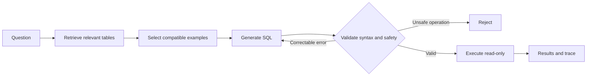

# Text2SQL Agent

[](https://github.com/Wilhelmvsop/Text2SQL-agent/actions/workflows/tests.yml)

Ask questions about a SQLite database in plain English and get back validated, read-only SQL,
its results, and a step-by-step trace of how the answer was produced.

Text2SQL Agent finds the tables relevant to a question, asks a language model to write SQL,
checks that SQL for safety and correctness, corrects ordinary errors automatically, and runs
it through a protected read-only connection. It ships as a web app (React + FastAPI) and as a
command-line tool.

## Contents

- [Features](#features)
- [How It Works](#how-it-works)
- [Getting Started](#getting-started)
- [Command-Line Usage](#command-line-usage)
- [Configuration](#configuration)
- [Evaluation](#evaluation)
- [Development](#development)
- [Security Model](#security-model)
- [Limitations](#limitations)
- [Tech Stack](#tech-stack)

## Features

**Web app**

- **Guided setup in the browser.** Upload a SQLite database (or use the sample one) and connect
  a model on first launch. No `.env` file or CLI flags needed.
- **Live trace.** Each pipeline stage streams in as it finishes: retrieved tables with scores,
  few-shot examples, every SQL attempt with its error, a diff between attempts, and latency per stage.
- **Editable SQL.** Generated SQL opens in an editor with schema-aware autocomplete. It is
  re-validated as you type, and unsafe SQL cannot be run.
- **Result explorer.** Sort, filter, paginate, and export to CSV. A banner appears when the row limit truncates results.
- **Persistent history.** Search, star, and filter past queries. Each query has a shareable
  `/q/:id` URL, and hand-edited re-runs are nested under their original question.
- **Settings without restarts.** Model, retrieval, and database settings apply immediately. A
  model is saved only after it answers a test request; an invalid configuration is rejected and
  the previous one keeps running.

**Agent pipeline**

- Schema retrieval with pluggable embeddings (built-in hashing, Sentence Transformers, or an embeddings API)
- Few-shot example selection filtered by schema compatibility
- Any OpenAI-compatible Chat Completions API, hosted or local (OpenAI, DeepSeek, OpenRouter, Ollama, …)
- Layered validation and bounded self-correction; see [Security Model](#security-model)
- JSONL traces with latency, prompt size, and token usage
- An evaluation harness that compares execution results with reference queries

## How It Works



The web app adds a FastAPI server around this pipeline. The server streams each stage to the
browser over server-sent events and stores query history and settings in its own database
(`data/app.db`), kept separate from the database being queried.

The pipeline uses direct Python orchestration rather than LangChain or LlamaIndex, so each
stage and security boundary can be tested on its own.

## Getting Started

### Prerequisites

- Python 3.11 or newer
- Node.js 20 or newer, with Corepack (bundled with Node), to build the web app
- An API key for an OpenAI-compatible model, or a local [Ollama](https://ollama.com) server
- macOS, Linux, or Windows (PowerShell or WSL)

### Installation

```bash
git clone https://github.com/Wilhelmvsop/Text2SQL-agent.git
cd Text2SQL-agent

python3 -m venv .venv
source .venv/bin/activate          # Windows PowerShell: .venv\Scripts\Activate.ps1
python -m pip install -e '.[web]'

cd web
corepack pnpm install
corepack pnpm build
cd ..
```

### Run the Web App

```bash
text2sql-server
```

The app opens at <http://127.0.0.1:8000>. Use `--port` to change the port and `--no-browser`
to skip opening a browser.

On first launch, a setup screen walks through two steps:

1. **Database.** Drag in a SQLite file (`.db`, `.sqlite`, or `.sqlite3`, up to 200 MB), or
   choose the sample e-commerce database.
2. **Language model.** Pick a preset or enter a base URL, model name, and API key. The model
   must answer a short test request before it is saved.

The workspace stays locked until both steps are done. Both can be changed later in **Settings**.

### Demo Databases

[`examples/databases/`](examples/databases/README.md) contains five ready-to-upload databases
from different domains, each with questions to try:

| Database | Domain | SQL features exercised |
|---|---|---|
| `university.db` | Courses and grades | Multi-table joins, `NULL` grades for courses in progress |
| `hospital.db` | Appointments and prescriptions | Status filters, percentages, date-time ranges |
| `library.db` | Book loans | `NULL` return dates, overdue logic, fines |
| `streaming.db` | Movies, views, and reviews | Many-to-many relationships, `HAVING`, completion rates |
| `company.db` | Employees and projects | Manager self-joins, salary history, window functions |

## Command-Line Usage

The CLI runs the same pipeline without the web app. It also has an offline demo mode that replays
scripted model responses and needs no API key.

```bash
python -m text2sql.cli --init-db      # create the sample database at data/database.db
python -m text2sql.cli --demo         # offline demo: failed attempt, correction, safe execution
```

To ask your own questions, configure a model through environment variables (see
[Configuration](#configuration)):

```bash
cp .env.example .env                  # then fill in TEXT2SQL_LLM=api, base URL, model, and key
set -a; source .env; set +a           # the CLI does not load .env automatically

python -m text2sql.cli --question "List all customers from Canada. Return customer_id and name."
```

Running without `--question` starts an interactive prompt.

| Option | Description |
|---|---|
| `--init-db` | Create the deterministic sample database (refuses to overwrite) |
| `--db PATH` | Database to use (default: `TEXT2SQL_DB`) |
| `-q`, `--question TEXT` | Ask one question and exit |
| `--demo` | Offline demo with scripted model responses |
| `--json` | Print the full result and trace as JSON |
| `--llm {fake,api}` | Override the model provider |
| `--top-k N` | Number of tables to retrieve |
| `--full-schema` | Send every table to the model instead of retrieving Top-K |
| `--evaluate` | Run the benchmark (add `--smoke` for reference-query replay) |
| `--ablation` | Compare full-schema and Top-K retrieval |
| `--output PATH` | Where to write evaluation reports |

## Configuration

The CLI reads environment variables. The web app uses the same variables as its defaults, and
any value saved in **Settings** takes precedence.

| Variable | Default | Description |
|---|---|---|
| `TEXT2SQL_DB` | `data/database.db` | SQLite database to query |
| `TEXT2SQL_LLM` | `fake` | `api` for a real model; `fake` is the CLI's offline demo (the web app always requires a real model) |
| `TEXT2SQL_BASE_URL` | `http://localhost:11434/v1` | OpenAI-compatible API base URL |
| `TEXT2SQL_MODEL` | – | Model name |
| `TEXT2SQL_API_KEY` | – | API key (falls back to `OPENAI_API_KEY`) |
| `TEXT2SQL_EMBEDDING` | `hashing` | `hashing`, `sentence-transformers` (requires the `[neural]` extra), or `api` |
| `TEXT2SQL_EMBEDDING_MODEL` | `sentence-transformers/all-MiniLM-L6-v2` | Embedding model name |
| `TEXT2SQL_EMBEDDING_BASE_URL` | – | Embeddings API base URL |
| `TEXT2SQL_EMBEDDING_API_KEY` | – | Embeddings API key |
| `TEXT2SQL_TOP_K` | `4` | Tables retrieved per question |
| `TEXT2SQL_MAX_RETRIES` | `3` | Correction attempts after invalid SQL |
| `TEXT2SQL_TRACE` | `traces/queries.jsonl` | JSONL trace file |
| `TEXT2SQL_HISTORY` | `data/app.db` | Web app history and settings store |

## Evaluation

A real-model run with `deepseek-flash` on 25 questions over the sample database (7 tables,
1,939 records). Each generated query passed through the safety checks, ran against SQLite, and
was compared with the result of a reference query.

| Metric | Result |
|---|---:|
| Correct execution result | **23/25 (92%)** |
| Easy / medium / hard | 8/8 · 8/8 · 7/9 |
| Valid on first attempt | 23/25 (92%) |
| Valid after correction | 24/25 (96%) |
| Mean end-to-end latency | 2.03 s |

This is one run on a small benchmark: it shows that the approach works but is not a precise
accuracy estimate. Configuration, per-question artifacts, and metric definitions are in
[docs/EXPERIMENTS.md](docs/EXPERIMENTS.md).

To reproduce:

```bash
python -m text2sql.cli --init-db --db data/evaluation.db

# Offline: replays reference queries to check the pipeline and scoring (no API key)
python -m text2sql.cli --evaluate --smoke --db data/evaluation.db --output reports/local-oracle.json

# Compare full-schema context with Top-K retrieval (offline)
python -m text2sql.cli --ablation --smoke --db data/evaluation.db --output reports/local-ablation.json

# Real model: load your model settings first
python -m text2sql.cli --evaluate --db data/evaluation.db --output reports/local-real-model.json
```

## Development

### Project Structure

```text
text2sql/
├── agent/          # Pipeline orchestration and the correction loop
├── db/             # Schema introspection, sample data, read-only execution
├── evaluation/     # Benchmark runner and metrics
├── generation/     # Prompts, model providers, SQL generation
├── retrieval/      # Schema and few-shot retrieval
├── server/         # FastAPI app, settings runtime, history store, uploads
└── validation/     # SQL safety and validity checks
web/                # React + TypeScript frontend (Vite)
tests/              # Python tests
examples/databases/ # Demo databases with sample questions
scripts/            # Developer scripts
reports/            # Experiment artifacts
docs/               # Experiment record
```

### Running Tests

```bash
python -m unittest discover -v        # Python: pipeline, safety checks, API, uploads
cd web && corepack pnpm test          # Frontend: state, components, upload
```

The tests replace the language model with a scripted provider, so they need no API key. CI runs
both suites on every push, with Python 3.11, 3.12, and 3.13.

### Frontend Development

Run the API without opening a browser, then start the Vite dev server, which proxies `/api` to
port 8000:

```bash
text2sql-server --no-browser
cd web && corepack pnpm dev
```

### Rebuilding the Demo Databases

```bash
python scripts/make_demo_databases.py
```

The output is deterministic: the script produces byte-identical files on every run.

## Security Model

Model output is treated as untrusted. A query must pass every layer before it reaches the database:

| Layer | Protection |
|---|---|
| Static checks | SQLGlot AST analysis allows a single `SELECT`, restricts it to known tables, and checks join structure |
| Compilation | SQLite `EXPLAIN` catches unknown tables or columns and syntax errors before execution |
| Connection | Read-only mode (`mode=ro`, `query_only`), plus an authorizer that allowlists tables and functions |
| Resource limits | Time and step budgets per query; at most 1,000 rows returned |
| Correction | Ordinary errors are sent back to the model to fix; unsafe queries are rejected without retry |

For the web app specifically:

- **Separate stores.** History and settings live in `data/app.db`. The server refuses to use
  that file as the query database, so saved settings cannot be read through SQL.
- **Write-only API keys.** The server reports only whether a key is set and never returns it
  to the browser. Keys are stored unencrypted in `data/app.db`, which is git-ignored.
- **Upload checks.** Uploads are streamed with a size limit, verified by their SQLite header
  and `PRAGMA quick_check`, and saved as a private copy under a server-generated name.
- **Local only.** The server binds to `127.0.0.1` and has no authentication. It is a
  single-user local tool and should not be exposed to a network as is.

## Limitations

- Only SQLite databases are supported.
- Table descriptions and few-shot examples are written for the sample database. On uploaded
  databases, the model has less context and answers may be less accurate.
- Query history is shared across databases.
- There are no user accounts. The app is meant for one person on one machine.

## Tech Stack

**Backend:** Python 3.11+, FastAPI, SQLite, SQLGlot, NumPy

**Frontend:** React 18, TypeScript, Vite, TanStack Query, CodeMirror 6

**Testing and CI:** unittest, Vitest, Testing Library, GitHub Actions
